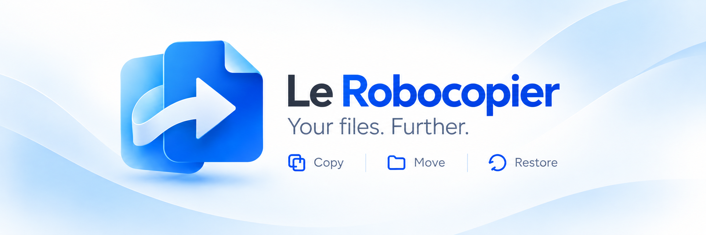



# Le Robocopier

**Your projects. Your files. Everything in its place.**

Le Robocopier brings your backups into one clear, organized workspace. Keep work documents, personal files, and client projects grouped by what matters to you, with a dedicated backup for each project.

## Make room for what matters

Choose the files and folders that belong together, give your project a name, and keep it within easy reach. A clean layout helps you find your projects and focus on the task at hand.

## Copy, move, restore

- **Copy** your project's files to its backup while keeping the originals where they are.
- **Move** files into the backup, freeing their original location after the copies have been checked.
- **Restore** backed-up items to their original locations when you need them again.

Follow each operation's progress and review its results, so you can see what happened to your files.

## A workspace that grows with you

Rename projects as your work evolves. Set inactive projects aside while keeping their backups, and bring them back when you need them. Change your backup location from Settings to keep your workspace aligned with the way you work.

**Bring order to your backups. Get back to your projects.**

## License

This project is licensed under the **MIT License**.

You are free to use, modify, and distribute this software, including for commercial purposes, as long as the original copyright notice and license are included.

See the [LICENSE](LICENSE) file for more details.
